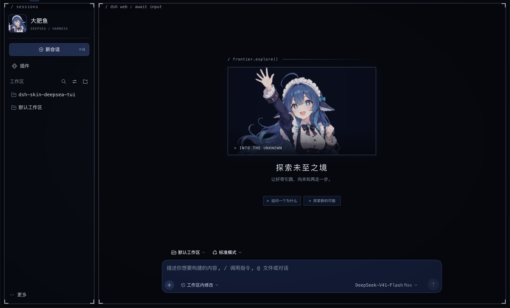

# 深海终端 · Deepsea TUI

给 DeepSeek Harness Desktop 换上一片深海：蓝色终端、微亮的窗口框线，还有陪你聊天与写代码的大肥鱼。

这是一款非官方终端风格皮肤，包含角色欢迎画面、实时会话状态和可选 CRT 动效。

适配 **DSH Desktop 0.2.0-rc.2（macOS / Windows）**。TUI 指终端风格的桌面界面；本皮肤运行于 DSH 的桌面前端。



*DSH Desktop 实际界面截图。*

## 功能

- 深海配色、终端框线、消息卡片与代码块。
- 大肥鱼头像、欢迎表情与日常文案，还有其他 AI 偶尔来访的彩蛋，留给你自行探索。
- 实时显示思考、工具执行、输出与等待确认等会话状态，配合竖条活动脉冲；底部显示 DSH 进程 CPU 占用。
- 可分别设置欢迎图、访客来访、底部状态栏、纹理暗角、动效与大肥鱼人设；动效遵循系统减少动态效果。

## 安装

**前置组件：皮肤管理器。** macOS 和 Windows 都需要额外安装并保持启用 [DSH Skin Manager](https://github.com/Small-tailqwq/dsh-deep-whale/tree/main/skin-manager)，它提供「设置 → 皮肤管理」入口，并显示本皮肤的 7 个设置项。仅安装皮肤包时，皮肤可能已经生效，但不会出现这些设置；本皮肤不会自动安装管理器。

先在 DSH 的「插件 → 添加插件」中添加以下管理器包（支持本皮肤使用的 v2 设置协议）：

```text
@smalltailqwq/dsh-client-ui-skin-deep-whale-manager@0.1.6
```

再在同一入口粘贴本皮肤的仓库链接，无需手动克隆仓库或编译：

```text
https://github.com/KeithTMaxwell/dsh-skin-deepsea-tui
```

安装并启用管理器和皮肤插件后，完全退出并重启 DSH，再到「设置 → 皮肤管理」选择「深海终端」，依次设置空白会话角色画面、访客网络、大肥鱼人设、底部状态栏、界面动效、CRT 静态纹理与暗角、增强 CRT 效果。

命令行安装（以下两条命令逐条执行，适用于 macOS 终端和 Windows PowerShell；需要已配置 `dsh` 命令）：

```bash
dsh plugin --profile desktop add '@smalltailqwq/dsh-client-ui-skin-deep-whale-manager@0.1.6' --ignore-scripts
dsh plugin --profile desktop add 'git+https://github.com/KeithTMaxwell/dsh-skin-deepsea-tui.git' --ignore-scripts
```

如果使用离线安装包，也可将其本地绝对路径填入「添加插件」，仍需单独安装皮肤管理器。不要同时启用旧包与新包。DSH 升级后可能需要重新适配。

如果看不到「皮肤管理」或皮肤设置项，先检查管理器是否安装在同一个 `desktop` profile 中、是否启用，并完全退出后重启 DSH。已使用 `@linxin666/dsh-web-all` 的用户应遵循其自带皮肤中心的安装说明，不要在同一 profile 中叠装此独立管理器。

“大肥鱼人设”默认开启，会影响当前 DSH 实例的模型回复语气，可在皮肤设置中关闭；关闭不会清除旧对话中的角色历史。皮肤本身不发送模型请求，CPU 数据在本地获取。预览中的状态为演示样例。

“访客网络”默认开启，可控制其他 AI 来访彩蛋。更多内容请自行探索。关闭此项会清空彩蛋进度，重新开启后从头开始。

## 参与者

ChatGPT、Claude、DeepSeek。详细分工见 [制作人员表](CREDITS.md)。

## 版权与来源

- **主题视觉参考：**[MisakaZentai](https://github.com/MisakaZentai) 的 [《world.execute(me);》TUI PV](https://github.com/MisakaZentai/world-execute-me-dsh-pv)，[原成片](https://www.bilibili.com/video/BV1xCai6aE9g/)。参考其深海配色、终端框线和 CRT 视觉风格。
- **宿主界面：**[DeepSeek Harness](https://github.com/deepseek-ai/deepseek-harness)，由 [DeepSeek](https://github.com/deepseek-ai) 提供。
- **皮肤维护与改编：**[KeithTMaxwell](https://github.com/KeithTMaxwell)。
- **内容灵感：**“白饭 / 电子口粮”参考 [YunYueSama/codex-deepseek-pet](https://github.com/YunYueSama/codex-deepseek-pet) 的社区同人设定。欢迎与访客台词为本皮肤同人文案。

### 角色原始出处与作者

| 内容 | 原作者与原始出处 | 后续素材来源 / 使用条件 |
| --- | --- | --- |
| 鲸鱼娘「溟月」原角色 | © [上善无形（Pixiv）](https://www.pixiv.net/users/62155430)，[Bilibili](https://space.bilibili.com/4456176) | 保留原角色署名；本包鲸鱼娘素材及改编遵循 CC BY-NC-SA 4.0 |
| 女仆版 DeepSeek 角色设计、原始立绘 | [ZipZipPipe（Pixiv）](https://www.pixiv.net/users/18604994)，[Bilibili](https://space.bilibili.com/4168597)；原作 [《AI娘化》](https://www.pixiv.net/artworks/148186519) | [Small-tailqwq/dsh-deep-whale](https://github.com/Small-tailqwq/dsh-deep-whale) 为下游素材整理来源，不是原画作者 |
| 鲸鱼娘八种表情 | 原角色及女仆设计署名同上 | [JAdpp/dsh-whale-galgame](https://github.com/JAdpp/dsh-whale-galgame)，[固定来源版本](https://github.com/JAdpp/dsh-whale-galgame/tree/046b848f244450e6e636335766276bf3343fe84b/assets/default)；表情整理及 AI 辅助处理，保留 CC BY-NC-SA 4.0 |
| ChatGPT、Claude 访客角色 | [ZipZipPipe《AI娘化》](https://www.pixiv.net/artworks/148186519) | 保留作者署名、不可商用要求；不将鲸鱼娘专属 CC 条款直接套用到访客图 |
| 访客及互动场景衍生插画 | 参考上述原角色与立绘，通过 AI 辅助生成或编辑 | 属同人改编，不是原作者新作；延续对应原素材使用条件，品牌图标权利归各自权利人 |


## 许可

本项目新增代码与改编采用 [PolyForm Noncommercial 1.0.0](LICENSE)，允许按条款进行非商业使用、修改与分发。上游 MIT 代码保留原授权，第三方素材保留各自的许可与使用条件。

鲸鱼娘素材及改编遵循 **CC BY-NC-SA 4.0**：署名、不得商用、注明修改、改编按相同许可分享。ChatGPT / Claude 素材保留原作者署名与不可商用要求，不直接套用鲸鱼娘的 CC 条款。完整许可范围及素材改编声明见 [NOTICE.md](NOTICE.md)。

本项目为非官方同人皮肤，不代表相关品牌或原作者的认可或合作。不包含歌曲、歌词、原片舞者视频或字体文件。
